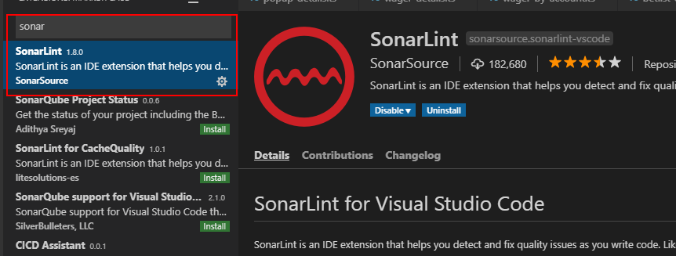
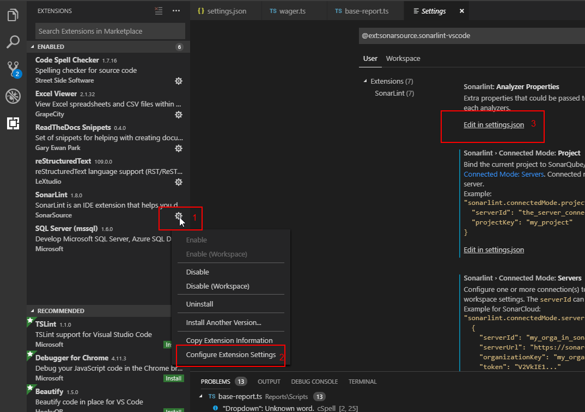
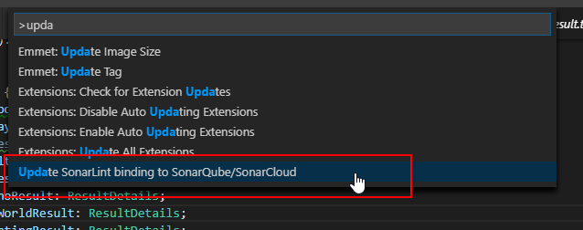
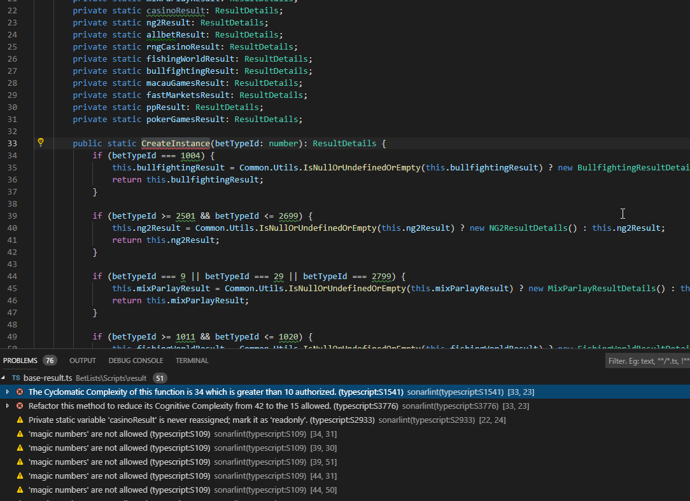
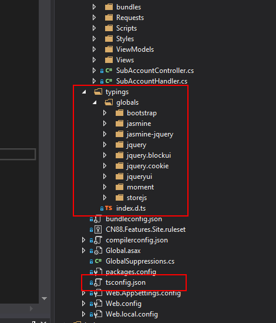
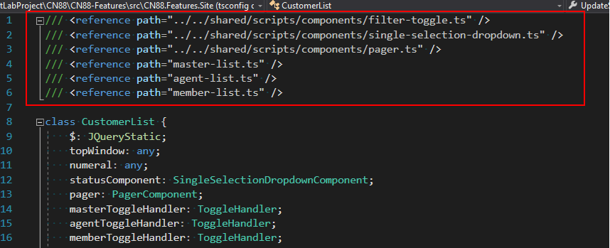

**************************
Typescript Guidelines
**************************

Please follow these steps to config and check sonarqube for typescipt file

**Step 1. Link project to sonarqube server using Visual Studio Code**

Install **Visual Studio Code** and **SonarLint** extension first, then open project website folder, follow this image to config:

After clicked on Edit in settings.json, config your project like this:

.. code:: json

        {
            "terminal.integrated.shell.windows": "C:\\WINDOWS\\System32\\cmd.exe",
            "sonarlint.ls.javaHome": "C:\\Program Files\\Java\\jdk1.8.0_11",
            "sonarlint.connectedMode.servers": [
                {
                    "serverId": "localsonarqube",
                    "serverUrl": "http://sonarqube.nexdev.net",
                    "token": "d1f2bdcb11993b2f61fbb2e7e96c5461b95158ea" 
                }],
            "sonarlint.connectedMode.project": {  
                    "serverId":"localsonarqube",
                    "projectKey": "CN88-Features"
                }
        }

Go to http://sonarqube.nexdev.net/account/security/ to get your login token

**Step 2. Update latest rules (for first time), check your ts file errors and enjoy fixing**

Press Ctrl + Shift + P to open command pallet, then run "Update SonarLint binding to SonarQube/SonarCloud" to bind with server

Enjoy fixing

**If you caught not reference type in visual studio code, please add typings, tsconfig.json, relative reference file path to your project/ts file**

